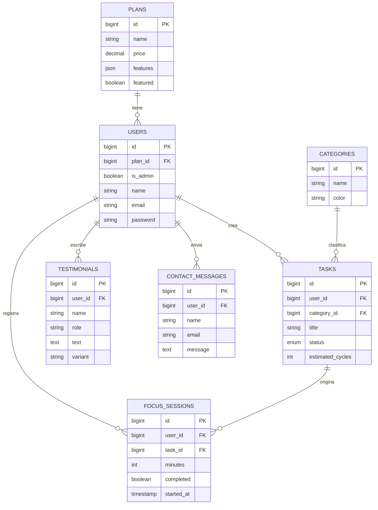
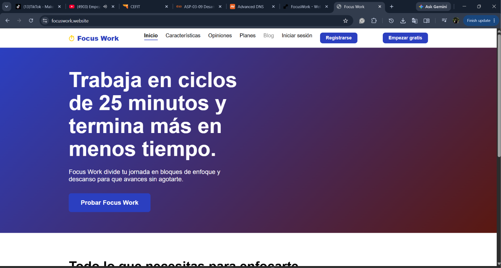
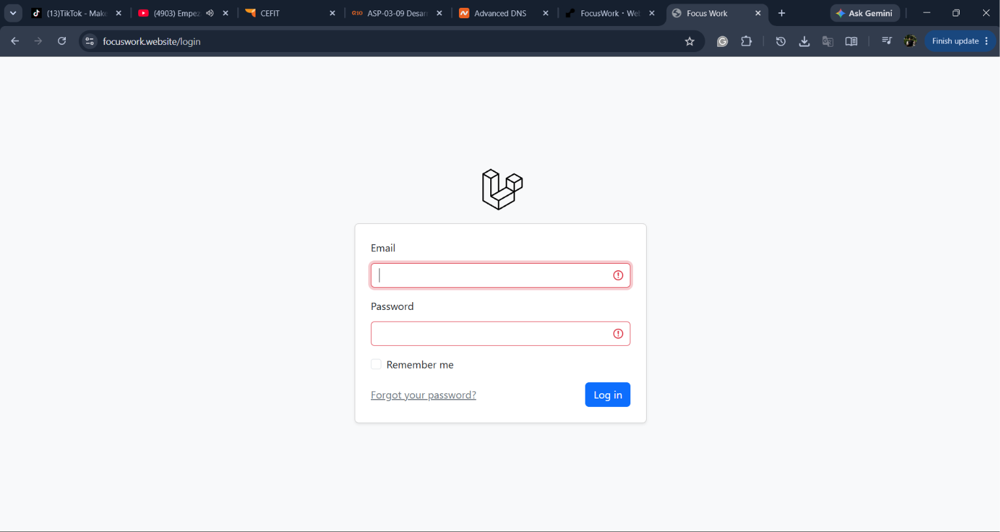
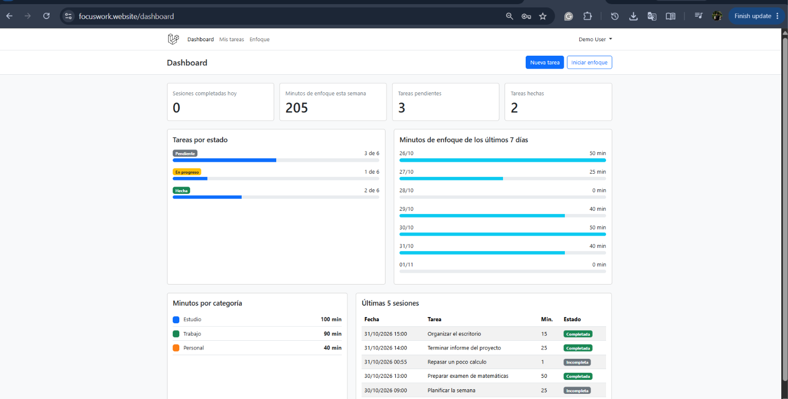
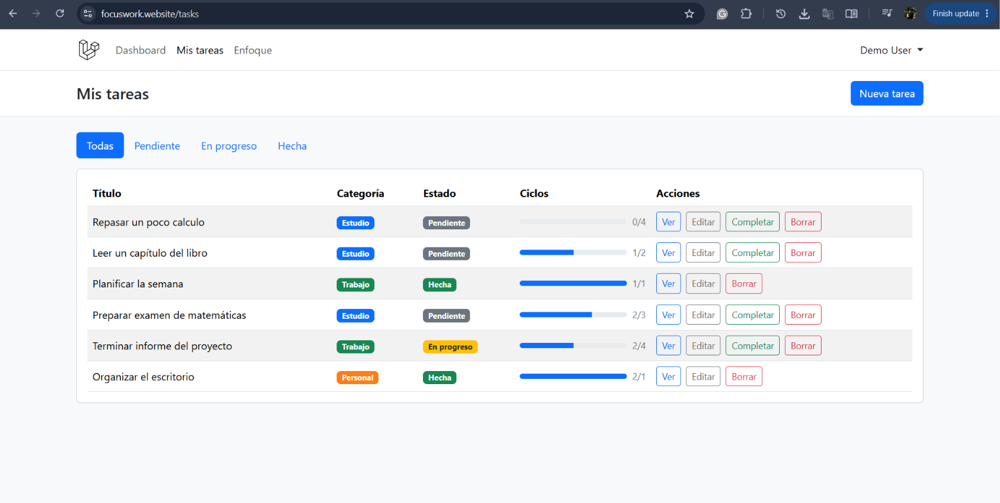
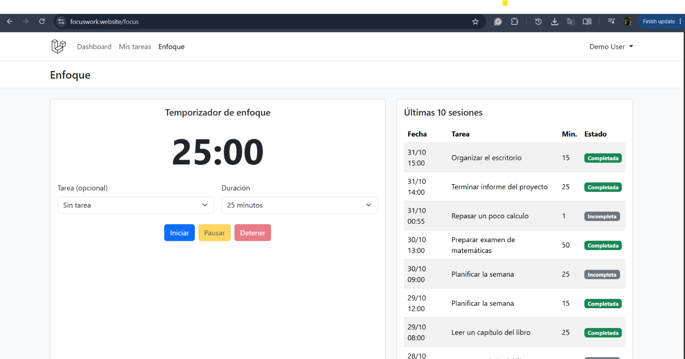
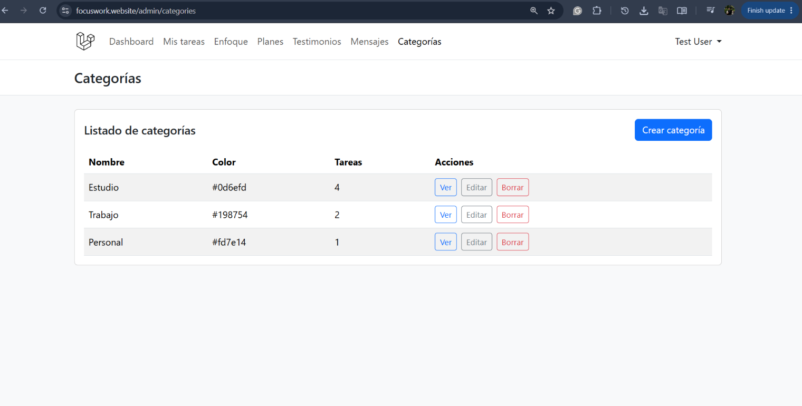
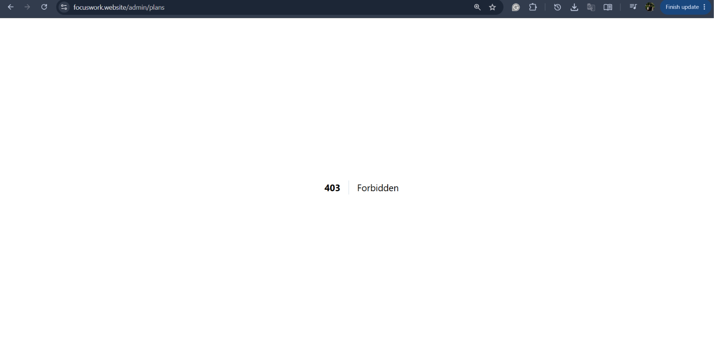

# Focus Work

Trabaja en ciclos de 25 minutos y termina más en menos tiempo.

**Estudiante:** Sebastian Muñoz Bermudez
**Curso:** Laravel (proyecto práctico)

**Aplicación en producción:** https://focuswork.website
**Repositorio:** https://github.com/ZebaZTech/Conocmiento-BEM

## Descripción

Focus Work es una aplicación web para trabajar en ciclos de enfoque tipo Pomodoro. Permite gestionar tareas y categorías, usar un temporizador de enfoque, consultar el historial de sesiones y revisar estadísticas. Incluye autenticación de usuarios y un panel de administración para gestionar el contenido del sitio.

## Tecnologías

| Tecnología | Versión |
| --- | --- |
| PHP | ^8.3 |
| Laravel | ^13.17 |
| Blade | Incluido en Laravel |
| Bootstrap | ^5.3.8 |
| Vite | ^8.0.0 |
| Pest | ^4.7 |
| MySQL | Base de datos local |
| PostgreSQL | Base de datos en producción |

## Funcionalidades

### Sitio público

- Landing, características, opiniones, planes y contacto.
- Estilos propios con metodología BEM.
- Formulario de contacto con límite de 5 envíos por minuto.

### Usuario autenticado

- Tareas: crear, listar, ver, editar, eliminar y marcar como completadas.
- Enfoque: temporizador de ciclos y registro de sesiones.
- Dashboard: resumen de tareas y estadísticas de enfoque.
- Perfil: actualización de datos y eliminación de la cuenta.

### Administrador

- Planes: CRUD completo.
- Testimonios: CRUD completo.
- Categorías: CRUD completo.
- Mensajes de contacto: listado, detalle y eliminación.

El acceso al panel se protege con el middleware `admin`, que responde con un error 403 si el usuario no es administrador. La `TaskPolicy` garantiza que cada usuario solo pueda ver, actualizar y eliminar sus propias tareas.

## Base de datos

| Tabla | Columnas principales |
| --- | --- |
| `users` | `id`, `plan_id`, `is_admin`, `name`, `email`, `email_verified_at`, `password`, `remember_token`, `created_at`, `updated_at` |
| `plans` | `id`, `name`, `price`, `description`, `features`, `excluded_features`, `period`, `featured`, `created_at`, `updated_at` |
| `categories` | `id`, `name`, `color`, `created_at`, `updated_at` |
| `tasks` | `id`, `user_id`, `category_id`, `title`, `notes`, `status`, `estimated_cycles`, `created_at`, `updated_at` |
| `focus_sessions` | `id`, `user_id`, `task_id`, `minutes`, `completed`, `started_at`, `created_at`, `updated_at` |
| `testimonials` | `id`, `user_id`, `name`, `role`, `text`, `initials`, `variant`, `created_at`, `updated_at` |
| `contact_messages` | `id`, `user_id`, `name`, `email`, `message`, `created_at`, `updated_at` |

### Relaciones

- `User` pertenece a `Plan` (`belongsTo`).
- `User` tiene muchas `Task` (`hasMany`).
- `User` tiene muchas `FocusSession` (`hasMany`).
- `User` tiene muchos `Testimonial` (`hasMany`).
- `User` tiene muchos `ContactMessage` (`hasMany`).
- `Plan` tiene muchos `User` (`hasMany`).
- `Category` tiene muchas `Task` (`hasMany`).
- `Task` pertenece a `User` (`belongsTo`).
- `Task` pertenece a `Category` (`belongsTo`).
- `Task` tiene muchas `FocusSession` (`hasMany`).
- `FocusSession` pertenece a `User` (`belongsTo`).
- `FocusSession` pertenece a `Task` (`belongsTo`).
- `Testimonial` pertenece a `User` (`belongsTo`).
- `ContactMessage` pertenece a `User` (`belongsTo`).

### Diagrama entidad-relación



## Rutas principales

### Públicas

| Método | URL | Acción |
| --- | --- | --- |
| GET | `/` | Landing de Focus Work |
| GET | `/caracteristicas` | Página de características |
| GET | `/opiniones` | Página de opiniones |
| GET | `/planes` | Página de planes |
| GET | `/contacto` | Formulario de contacto |
| POST | `/contacto` | Guarda un mensaje de contacto |
| GET | `/login` | Formulario de inicio de sesión |
| POST | `/login` | Inicia sesión |
| GET | `/register` | Formulario de registro |
| POST | `/register` | Registra un usuario |

### Usuario autenticado

| Método | URL | Acción |
| --- | --- | --- |
| GET | `/dashboard` | Panel del usuario |
| GET | `/tasks` | Lista de tareas |
| POST | `/tasks` | Crea una tarea |
| GET | `/tasks/{task}` | Detalle de una tarea |
| GET | `/tasks/{task}/edit` | Edición de una tarea |
| PUT/PATCH | `/tasks/{task}` | Actualiza una tarea |
| DELETE | `/tasks/{task}` | Elimina una tarea |
| PATCH | `/tasks/{task}/complete` | Marca una tarea como completada |
| GET | `/focus` | Temporizador de enfoque |
| POST | `/focus-sessions` | Registra una sesión de enfoque |
| GET | `/profile` | Edición del perfil |
| PATCH | `/profile` | Actualiza el perfil |
| DELETE | `/profile` | Elimina la cuenta |

### Administrador

| Método | URL | Acción |
| --- | --- | --- |
| GET | `/admin/plans` | Lista de planes |
| POST | `/admin/plans` | Crea un plan |
| PUT/PATCH | `/admin/plans/{plan}` | Actualiza un plan |
| DELETE | `/admin/plans/{plan}` | Elimina un plan |
| GET | `/admin/testimonials` | Lista de testimonios |
| POST | `/admin/testimonials` | Crea un testimonio |
| PUT/PATCH | `/admin/testimonials/{testimonial}` | Actualiza un testimonio |
| DELETE | `/admin/testimonials/{testimonial}` | Elimina un testimonio |
| GET | `/admin/categories` | Lista de categorías |
| POST | `/admin/categories` | Crea una categoría |
| PUT/PATCH | `/admin/categories/{category}` | Actualiza una categoría |
| DELETE | `/admin/categories/{category}` | Elimina una categoría |
| GET | `/admin/contact-messages` | Lista de mensajes de contacto |
| GET | `/admin/contact-messages/{contactMessage}` | Detalle de un mensaje |
| DELETE | `/admin/contact-messages/{contactMessage}` | Elimina un mensaje |

## Ejecución local

Requisitos: PHP 8.3 o superior, Composer, Node.js, npm y MySQL.

1. Clonar el repositorio.

PowerShell:

```powershell
git clone https://github.com/ZebaZTech/Conocmiento-BEM.git
cd Conocmiento-BEM
```

Bash:

```bash
git clone https://github.com/ZebaZTech/Conocmiento-BEM.git
cd Conocmiento-BEM
```

2. Instalar dependencias de PHP.

```bash
composer install
```

3. Instalar dependencias de JavaScript.

```bash
npm install
```

4. Crear el archivo `.env` a partir de `.env.example`.

PowerShell:

```powershell
Copy-Item .env.example .env
```

Bash:

```bash
cp .env.example .env
```

5. Generar la clave de la aplicación.

```bash
php artisan key:generate
```

6. Configurar la base de datos. El proyecto usa MySQL en local. Crea la base de datos y ajusta estas variables en `.env` (el archivo `.env.example` trae SQLite por defecto, así que reemplaza esa configuración):

```dotenv
DB_CONNECTION=mysql
DB_HOST=127.0.0.1
DB_PORT=3306
DB_DATABASE=focuswork
DB_USERNAME=root
DB_PASSWORD=
```

Puedes crear la base de datos desde MySQL:

```sql
CREATE DATABASE focuswork CHARACTER SET utf8mb4 COLLATE utf8mb4_unicode_ci;
```

7. Ejecutar migraciones y datos de ejemplo.

```bash
php artisan migrate --seed
```

8. Compilar los assets para producción o iniciar Vite en desarrollo.

```bash
npm run build
```

```bash
npm run dev
```

9. Iniciar el servidor.

```bash
php artisan serve
```

La aplicación queda disponible en http://localhost:8000. Si usas `npm run dev`, déjalo corriendo en otra terminal.

## Usuarios de prueba

| Rol | Correo | Contraseña |
| --- | --- | --- |
| Administrador | test@example.com | password |
| Usuario normal | demo@example.com | password |

## Pruebas

El proyecto usa Pest. Para ejecutar la suite:

```bash
php artisan test
```

La suite contiene 64 pruebas y 175 aserciones. Las pruebas usan SQLite en memoria según `phpunit.xml`.

## Despliegue

La aplicación está desplegada en Render con Docker. El `Dockerfile` compila los assets con Node.js y ejecuta Laravel sobre `php:8.4-apache`. La base de datos es un PostgreSQL gestionado por Render. El dominio propio `focuswork.website` se administra en Namecheap.

Se usó Render en lugar de Railway por indicación del docente, ya que Railway estaba fuera de servicio.

Variables de entorno necesarias (sin valores secretos):

- `APP_NAME`
- `APP_ENV`
- `APP_KEY`
- `APP_DEBUG`
- `APP_URL`
- `APP_LOCALE`
- `APP_FALLBACK_LOCALE`
- `LOG_CHANNEL`
- `LOG_LEVEL`
- `DB_CONNECTION` (`pgsql` en producción)
- `DB_URL` (URL interna de la base PostgreSQL de Render)
- `SESSION_DRIVER`
- `CACHE_STORE`
- `QUEUE_CONNECTION`
- `FILESYSTEM_DISK`
- `MAIL_MAILER`
- `MAIL_FROM_ADDRESS`
- `MAIL_FROM_NAME`
- `RUN_SEED` (opcional, solo para ejecutar los seeders en el primer despliegue)

Render asigna el puerto mediante `PORT`, que `docker/start.sh` usa para configurar Apache.

## Capturas de pantalla

### Landing



Página de inicio con el mensaje principal y las llamadas a la acción.

### Inicio de sesión



Formulario de acceso para usuarios registrados.

### Dashboard



Resumen de tareas y estadísticas de enfoque del usuario.

### Tareas



Listado y gestión de tareas por categoría y estado.

### Enfoque



Temporizador de ciclos de enfoque y registro de sesiones.

### Administración de categorías



Panel de administración para crear, editar y eliminar categorías.

### Error 403



Respuesta del middleware `admin` cuando un usuario sin permisos intenta acceder al panel.
